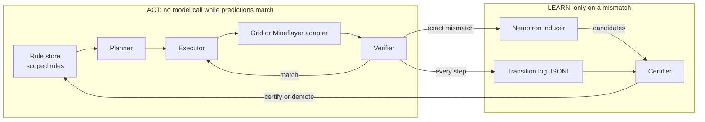

# Design: Breach (working name)

A Minecraft agent that plans from certified world rules, never from stored
procedures. When a server changes any rule, it catches the change at the step,
revises the rule, and re-certifies it by replaying its own log.

Started from the SchemaVoyager starter (LuizFelipeBarbosa/schema-voyager,
commit f9dd6fc). Built independently; the better project is presented.

## Claim

Worst case over every single-rule change in the benchmark class: bounded
recovery, zero immediate repeats, zero text-model calls on the next task on
the same server.

## Decisions (locked 2026-10-17)

| Area | Decision |
|---|---|
| Memory | Rules only. No skill library. Plans are recomputed from certified rules every time. |
| Planner | Minimum-action goal regression over certified rules in the current server scope. Travel cost from the last observation; a constant when the block is unknown. A hypothesis enters a plan only as a marked test step when no certified plan exists. |
| Scope | Rules are global or server-scoped. A contradiction demotes in the server's scope and leaves the global rule intact. No promotion to global. |
| Verification | Exact class is a whitelist by (action, block or recipe). Tolerant for navigation. `quarantined` verdict when a death, damage, or despawn event fired during the step. Mining is two checks: block removed (exact), item collected (tolerant). |
| Recovery | Exact contradiction: demote, ask Nemotron for at most 3 candidates, test them cheapest-discriminating first, re-certify by replay. If all fail, one more round with every counterexample. Then the rule is unknown; the planner routes around it or the episode fails and says why. |
| Probe | `probe(item)`: place the hypothesized grid, read the output slot, take ingredients back. One action, no consumption. The grid env has the same action. |
| Adversary | The class of single-rule changes: every tech-tree recipe × {output count, one ingredient added, one ingredient swapped} and every block drop × {different item, nothing}. One generator emits each change as a grid ruleset and as a 1.16.5 datapack. Live proof: a seeded random draw on stage; a judge's pick on request. |
| Baseline B | rmalde/minecraft-agent's architecture: observation menu, bundled recipes, async LLM planner, failure cooldown. Python port on the grid; his code on the Minecraft server. Jev is the per-step chooser in B only. |
| Text model | Nemotron 3 Super (Crusoe Managed Inference, fallback build.nvidia.com) for induction and for the planners in A and B. Thinking on with a 2k budget for induction, off elsewhere. Ollama `nemotron-3-nano:4b` as the offline inducer. |
| Nemotron prize | Tier ablation (Super vs Nano 30B vs Nano 4B) on the grid; NeMo Gym environment wrapper and transition-log export. No NemoClaw. |
| Minecraft | Java 1.16.5, vanilla server, Peaceful, `doDaylightCycle false`, `keepInventory true`, world border, reset from a saved world folder. Datapacks `pack_format` 6, `data/minecraft/recipes/`. |
| Footage | Real 1.16.5 client in spectator mode on the bot, OBS capture, banner as an OBS browser source fed by the status endpoint. |
| Code split | Python core (grid, store, planner, verifier, certifier, inducer client, evaluator, proof script). Node adapter (Mineflayer) over local HTTP. |

## Architecture



## Rule schema

```json
{
  "rule_id": "craft:stick",
  "action": "craft",
  "target": "stick",
  "delta": {"planks": -2, "stick": 4},
  "tool": null,
  "near": "crafting_table",
  "cls": "exact",
  "status": "certified",
  "scope": "global",
  "source": "prior",
  "evidence": ["t1/3", "t2/7"],
  "revision_of": null
}
```

`delta` carries consumption (negative) and production (positive). Inventory
preconditions are the negative entries. `tool` is the minimum tool tier held
(not consumed). `near` is the block that must be in reach. A rule with a
free-text precondition cannot be represented and is rejected at parse.

Items use generic names (`log`, `planks`, `stick`, `cobblestone`, `coal`).
The adapter normalizes wood variants.

## Transition record

One JSONL line per adapter action:

```json
{"episode": "t1", "step": 3, "server": "grid/vanilla", "obs_hash": "…",
 "action": "craft", "target": "stick", "rule_id": "craft:stick",
 "predicted": {"planks": -2, "stick": 4}, "observed": {"planks": -2, "stick": 2},
 "cls": "exact", "verdict": "mismatch", "test": false}
```

Replaying the log reproduces every verdict. Log length equals the action count.

## Adapter contract (Node over local HTTP)

- `POST /reset` body `{task}` → observation plus `message` (the commands issued)
- `GET /observe` → observation
- `POST /step` body `{action, target}` → `{ok, message, output, events, observation}`

Observation: `{server, position: {x,y,z}, inventory: {item: n}, visible:
[{x,y,z,block}], action_count, budget, done, success}`. `events` lists
death, damage, despawn seen during the step (drives `quarantined`).
Actions: `move(direction|toward block)`, `mine`, `craft(item)`,
`probe(item)`, `place(item)`, `look`. `place` puts a held block on an
adjacent solid spot; a 3×3 craft or probe needs a crafting table within 4
blocks and never auto-places. Crafting takes `grid` as an item multiset; the
adapter lays known vanilla shapes out correctly (shape knowledge only, the
server still decides what the grid produces; our datapack overrides are
shapeless) and accepts explicit rows as an override.

## Change class

One definition file per change: `{"id": "stick-count-2", "recipe": "stick",
"kind": "count", "value": 2}` or `{"kind": "add_ingredient", "value":
{"coal": 1}}`, `{"kind": "swap_ingredient", "value": {"planks": "log"}}`,
`{"block": "stone", "kind": "drop", "value": {"stone": 1}}`, `{"kind":
"drop", "value": {}}`. The generator writes the grid ruleset and the
datapack from the same file and excludes changes that leave no certified
plan to the chosen goal.

## Benchmark

| Set | Content | Goal |
|---|---|---|
| T1 to T3 | vanilla, empty inventory | wooden pickaxe, stone pickaxe, furnace |
| H1 | vanilla, new seed, 4 planks + crafting table held | stone pickaxe |
| H2 | vanilla, no trees within 32 blocks | wooden pickaxe |
| HC | one world per change, empty inventory | cheapest goal whose plan uses the changed rule |
| HR | vanilla start, the change loaded by `/reload` before the first planned use of the rule | same goal |
| HS | same server as the previous HC or HR world, memory carried | new goal using the revised rule |

Systems: A (no memory, Nemotron per task), B (rmalde architecture), C (rules,
no step check), D (full). Grid: all systems, every HC world, 5 seeds.
Minecraft: B and D, 1 seed, H1, H2, three HC worlds, HR, HS, plus the live draw.

## Metrics

Holdout success, actions per success, actions after contradiction,
immediate repeat rate, recovery latency (worst case over the class is the
headline row), text-model calls and tokens, order violations, Nemotron tier
ablation. All computed by the proof script from the transition log.

## Milestones and gates

| M | Lane | Builds | Gate |
|---|---|---|---|
| M0 | core | Typed rules, store-only planner, transition log, grid seeds and rulesets, probe | Empty store → zero crafts on T1. A stick-count ruleset aborts at the craft step. Same seed loads identically. |
| M1 | core | Verifier classes, quarantined verdict, certifier by replay, server-scoped demotion | Synthetic-log tests per certification condition. After a server demotion, vanilla T1 still plans with the global rule. |
| M2 | core | Nemotron inducer with schema gate, test selection, bounded recovery, Ollama fallback | A random change world recovers within the bound; the next task on that server makes zero text-model calls. |
| M3 | core | Change-class generator, systems A to D on the grid, full matrix × 5 seeds, proof.json, results table | Matrix runs from one command; the worst-case row is populated. |
| M4 | adapter | JDK, 1.16.5 server, gamerules, world border, saved-world reset, datapacks and `/reload`, Mineflayer adapter | Core completes T1 in the real world, zero exact mismatches. A scripted craft under a count datapack returns the changed count. |
| M5 | adapter | rmalde's repo as B on our server, events converter | Proof script runs on his events.jsonl; his run under a precondition change is logged to the end of its budget. |
| M6 | both | HR and HS on Minecraft, D and B | HS proof: 0 contradictions, 0 text-model calls. HR proof: actions after contradiction = 0. |
| M7 | demo | Spectator client, OBS, banner, dashboard from log and proofs, recordings | Recorded HR plays with the banner; the site has no literal numbers. |
| M8 | core | Nemotron tier ablation, NeMo Gym wrapper and export | Ablation row exists; the export loads in a smoke test. |
| M9 | all | Rehearsal, freeze | Full demo twice without edits. |

Cut order if behind: M8 sizes (keep Super vs 4B), M5 public release, H2
glance arm, dashboard polish. Never cut: M0 to M4, M6, the proof script, the
recordings.

## Operator queue

- Crusoe org and the $50 credit form; build.nvidia.com key as fallback.
- Jev key for B (TypeSafe).
- Minecraft EULA acceptance for the local server (`eula=true` is the operator's act).
- Repo name and GitHub remote.
- Decide whether the comparison with rmalde's harness is published.

## Site data contract

`runs/<run>/status.json` is rewritten by the executor after every step and
rule status change (atomic rename); `site/README.md` is the field contract
and `site/fixtures/` holds worked examples. `proof.json` carries `episodes`,
`rows` (per system: one worst row, then mean rows per task set), and per
system `worst_case: {episode, recovery_latency}` and `aggregate`. The runner
keeps `runs/latest` as a symlink to the newest run.

## Gate commands

- `python3 -m unittest discover -s tests -t .` (core)
- `node --test` in `adapter/` after `npm ci` (adapter)
- `node site/check.mjs` (site)
- `python3 -m breach.proof runs/<run>` (claims)
